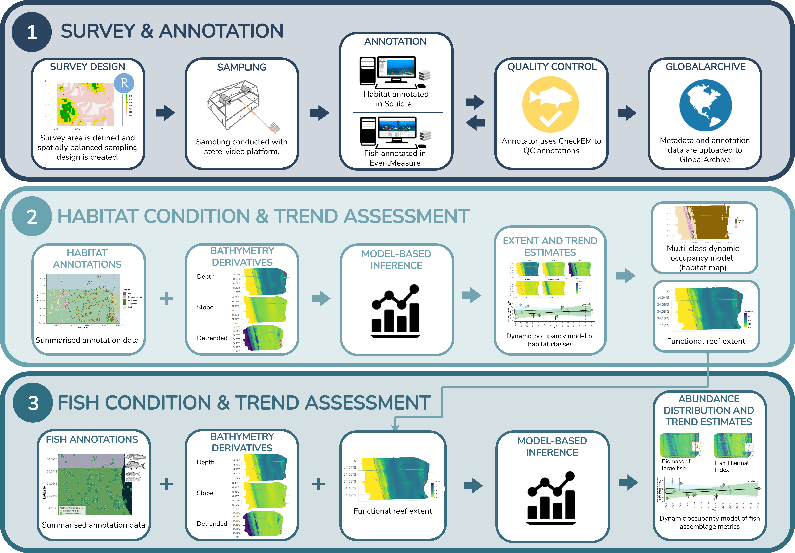

# australian-marine-parks

## Steps to use this template for a new marine park:

1.  Copy the `r/TEMPLATE/` folder and save in the `r/` folder as your park name.
2.  Edit `r/[YOUR_PARK]/02_create-report_appendix-A-natural-values/00_config.yml` and `r/[YOUR_PARK]/03_create-report_appendix-B-pressures/00_config.yml` to set your marine park and project name (currently set to "template")
3.  Copy `TEMPLATE/` folders in `data/`, `output/model-output/`, and `plots/` and save as your park name.
4.  Run scripts in number order.
    - The template scripts were duplicated from the Geographe marine park, so they need to be read through and edited to be appropriate for your park.
    - To do this, Look out for TODO notes where specific edits for your park/analysis are required. Run `todor::todor(search_path = "r/[YOUR_PARK]")` to view full list of required edits.
5.  Text in Quarto markdowns need to be edited heavily.
6.  Look out for commits beginning with 'TEMPLATE:', these contain changes to the template scripts and will probably improve your analysis, so you will need to look at what changes were made and copy them into your scripts.

## Website

The website at <https://uwa-marine-ecology-group-quartos.github.io/MACpaca/> is built automatically.
Every time something in `quartos/`, `images/parks/` or `site/` is pushed to `main`, the GitHub Action
`.github/workflows/deploy-site.yml` rebuilds the page and publishes it (usually within 1–2 minutes).

Only reports that exist as `.html` files become links. Reports listed as planned but not yet rendered show greyed out as "In preparation".

### Files

| File | What it does | Edit it? |
|------|--------------|----------|
| `site/parks.yml` | List of parks: name, network, report folders, photo and credit, GlobalArchive synthesis IDs, planned reports | **Yes**, this is the only file you normally need to edit |
| `site/template.html` | Page layout and text (header, intro, workflow, footer) | Only to change wording or layout |
| `site/style.css` | Colours and styling | Only to change the look |
| `site/build_site.py` | Script that builds the page | Rarely |
| `.github/workflows/deploy-site.yml` | Runs the build and publishes to GitHub Pages | Rarely |

Don't edit `index.md` or `_site/`. The live page is generated, so manual edits there are overwritten.

### Add a new report for an existing park

1. Render the Quarto document to HTML in that park's folder, e.g. `quartos/geographe/`. If the HTML isn't self-contained, commit its `_files/` folder too.
2. Keep the usual file name pattern so the appendix code and title are read automatically:
   `Project 4.21-<Park>-<n>-Appendix <code>-q-<Title>.html`
   e.g. `Project 4.21-Geographe-2-Appendix B-q-Pressures.html` → **B Pressures**.
3. Commit and push to `main`. The link appears on the website automatically.
   If the report was listed under `planned:` in `site/parks.yml`, the "In preparation" label is replaced by the link. You can then remove it from `planned:`.

Only `.html` files sitting directly in the park folder are linked. Files in sub-folders (e.g. `quartos/geographe/archive/`) and PDFs are ignored.

### Add a new park

1. Render its reports into a new folder, e.g. `quartos/my-park/`.
2. Add a block to `site/parks.yml` (copy an existing one):

   ```yaml
   - name: My Marine Park
     subtitle: Optional second line          # optional
     network: south-west                     # must match an id under networks:
     folders: [my-park]                      # folder(s) in quartos/
     code: r/my-park                         # analysis code folder (linked to GitHub)
     image:
       file: images/parks/my.park.jpg
       caption: What the photo shows
       credit: Photographer name             # leave out if the source names none
       source: https://australianmarineparks.gov.au/parks/...   # page the photo came from
     syntheses:
       - {label: BRUV, id: 72}               # GlobalArchive synthesis IDs
       - {label: BOSS, id: 85}
     planned:                                # reports not rendered yet (optional)
       - {code: B, title: Pressures}
       - {code: C, title: Data analysis}
   ```

3. Commit and push.

If you forget step 2, a new `quartos/` folder with reports still gets a basic card (under "Other sites", without a photo) until it's added to `parks.yml`.

**More options in `parks.yml`:**
- NPZ-only (or other) sub-analyses: list the folder with a suffix, e.g. `folders: [ningaloo, {path: ningaloo_npz02, suffix: (NPZ only)}]`.
- Reports whose file name doesn't follow the Appendix pattern: set a title with `titles: {DampierAMP-report: Dampier Marine Park report}`.
- Hide a `quartos/` folder from the site: add it to `hidden_folders:`.
- A new network: add it under `networks:` with an `id` and `name`.

### Park photos and credits

- Save photos in `images/parks/` (wide banner images work best; they're resized automatically).
- Always fill in `caption` and `source`, and `credit` when the source page names a photographer.
  The caption on the website reads "Photo: <credit>", or "Image: Australian Marine Parks" when there's no credit, and links to `source`.
- If a photo file is missing, the card shows a plain grey box until it's added.

### Change the workflow infographic

Replace `workflow.png` in the repo root and push. A web-sized copy is made automatically; the original is linked as "Open full-size infographic".

### Check or re-run a build

- **Check a build:** open the repo's **Actions** tab → "Build and deploy site". A green tick means it's live; a red cross means it failed (click it to see the error, often a typo in `parks.yml`).
- **Re-run by hand:** Actions → "Build and deploy site" → **Run workflow**.
- **Preview locally before pushing:**
  ```
  pip install pyyaml pillow
  python site/build_site.py
  ```
  Then open `_site/index.html` in a browser (`_site/` is git-ignored).

### One-off setup

In the GitHub repo: **Settings → Pages → Build and deployment → Source = GitHub Actions**.
